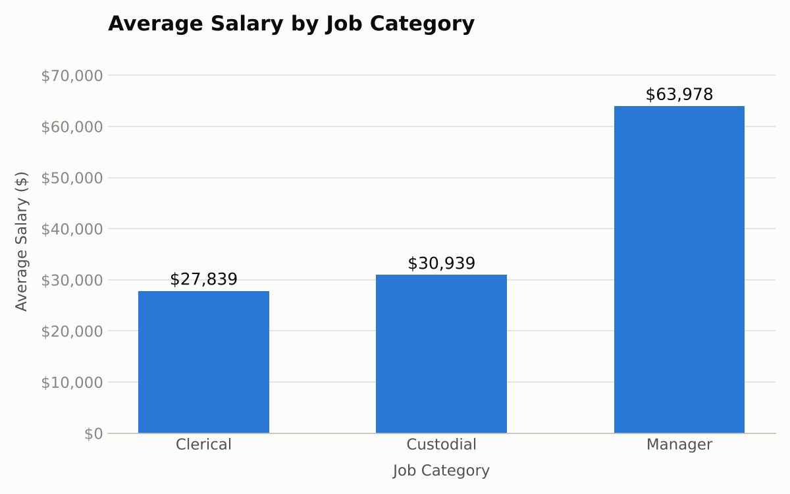
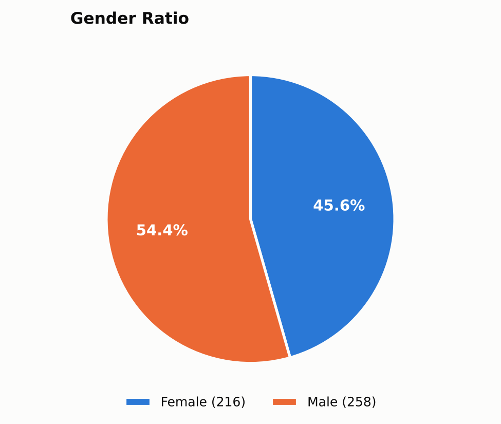

# Employee Data Analysis

An end-to-end spreadsheet analysis of a 474-record employee dataset: cleaning the raw data, calculating descriptive statistics, summarising with pivot tables, and visualising salary and workforce patterns in Google Sheets / Excel.

**Author:** Antony Wairia ([@WAIRIADEV](https://github.com/WAIRIADEV))

---

## Project Overview

The goal of this project is to take a raw CSV of employee records and turn it into clear, defensible insights about pay and workforce composition. The workflow follows four stages:

1. **Data cleaning** - import, de-duplicate, handle missing values, standardise types
2. **Descriptive statistics** - mean, median, mode, min, max, standard deviation, count
3. **Pivot tables** - group salary and headcount by category
4. **Visualisation** - column and pie charts with titles and data labels

## Dataset

`Employee_data.csv` - 474 rows, 10 columns.

| Column | Description |
|---|---|
| `id` | Employee ID |
| `gender` | Female / Male |
| `bdate` | Birth date |
| `educ` | Years of education |
| `jobcat` | Job category: Clerical, Custodial, Manager |
| `salary` | Current salary |
| `salbegin` | Starting salary |
| `jobtime` | Months in current job |
| `prevexp` | Previous work experience (months) |
| `minority` | Minority status: Yes / No |

## Data Cleaning

| Check | Finding | Action |
|---|---|---|
| Duplicate rows | None (no repeated rows or IDs) | Nothing removed |
| Blank values | 1 blank birth date (ID 434) | Left blank, not imputed |
| Placeholder text | 24 `"missing"` entries in `prevexp` | Converted to true blanks so averages are not distorted by fake zeros |
| Data types | Salaries as currency, birth date as short date, counts as numbers | Standardised |
| Whitespace | No stray leading/trailing spaces | No change needed |
| Possible outlier | ID 218: Clerical, starting salary $15,750, current salary $80,000 | Kept, flagged for review as a possible entry error |

## Descriptive Statistics (Current Salary)

| Statistic | Value |
|---|---|
| Mean | $34,420 |
| Median | $28,875 |
| Mode | $30,750 |
| Min | $15,750 |
| Max | $135,000 |
| Standard deviation | $17,076 |
| Count | 474 |

## Pivot Summaries

**By job category**

| Job Category | Headcount | Average Salary |
|---|---|---|
| Clerical | 363 | $27,839 |
| Custodial | 27 | $30,939 |
| Manager | 84 | $63,978 |

**By gender**

| Gender | Headcount | Share | Average Salary |
|---|---|---|---|
| Female | 216 | 45.6% | $26,032 |
| Male | 258 | 54.4% | $41,442 |

## Visualisations

Charts built from the pivot tables:

- **Average Salary by Job Category** - clustered column chart
- **Gender Ratio** - pie chart

<!-- Add your screenshots to an /images folder and update the file names below -->



## Key Insights

1. **Salary is right-skewed.** The mean ($34,420) sits well above the median ($28,875) because a small number of high-earning managers pull the average up.
2. **Job category is the main driver of pay.** Managers average $63,978, about 2.3 times the clerical average of $27,839.
3. **A gender pay gap exists.** Men average $41,442 versus $26,032 for women. Job mix explains part of this (managers are mostly men, and there are no women in Custodial roles), but men also out-earn women within Clerical roles ($31,558 vs $25,004).
4. **Clerical staff dominate headcount.** 363 of 474 employees (77%) are clerical.

## Limitations

- Findings are descriptive, not causal. The data does not include factors such as performance, hours, or full tenure that could explain pay differences.
- 24 records have no previous-experience value, so statistics for that column use 450 records.
- One possible data-entry outlier (ID 218) was retained.

## Repository Structure

```
.
├── README.md
├── Employee_data.csv              # raw dataset
├── Employee_Data_Analysis.xlsx        # cleaned data, summary stats, pivots, charts
└── images/                           # chart screenshots used in this README
```

## Tools Used

- Google Sheets / Microsoft Excel
  - Functions: `AVERAGE`, `MEDIAN`, `MODE.SNGL`, `MIN`, `MAX`, `STDEV.S`, `COUNT`, `TRIM`
  - PivotTables and charts

## How to Reproduce

1. Open `data/Employee_data.csv` in Google Sheets or Excel and save a copy as `.xlsx`.
2. Clean the data (duplicates, blanks, types) as described above.
3. Build the statistics table with the formulas listed above, pointing at the salary column.
4. Insert a PivotTable with `jobcat` in Rows and average `salary` in Values; insert a second with `gender` in Rows and a count of `id` in Values.
5. Insert a column chart from the first pivot and a pie chart from the second, then add titles and data labels.

## Author

**Antony Wairia** -  ALX Data Science & machine learning student; taking part in the Edulumos Data science internship. Based in Nakuru, Kenya.

GitHub: [@WAIRIADEV](https://github.com/WAIRIADEV)
